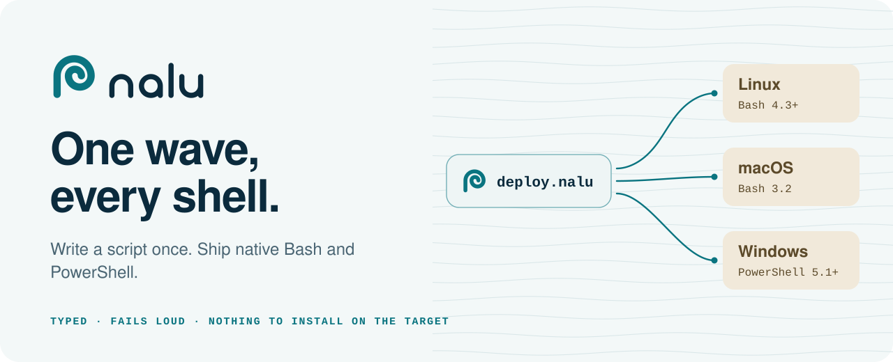
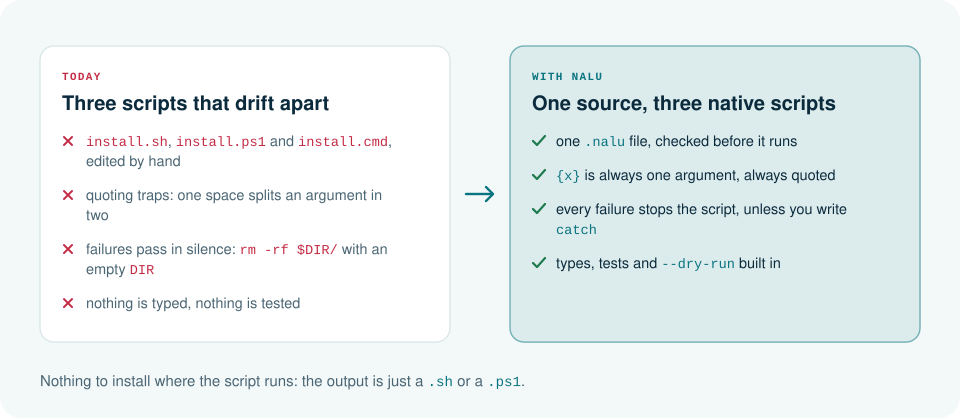
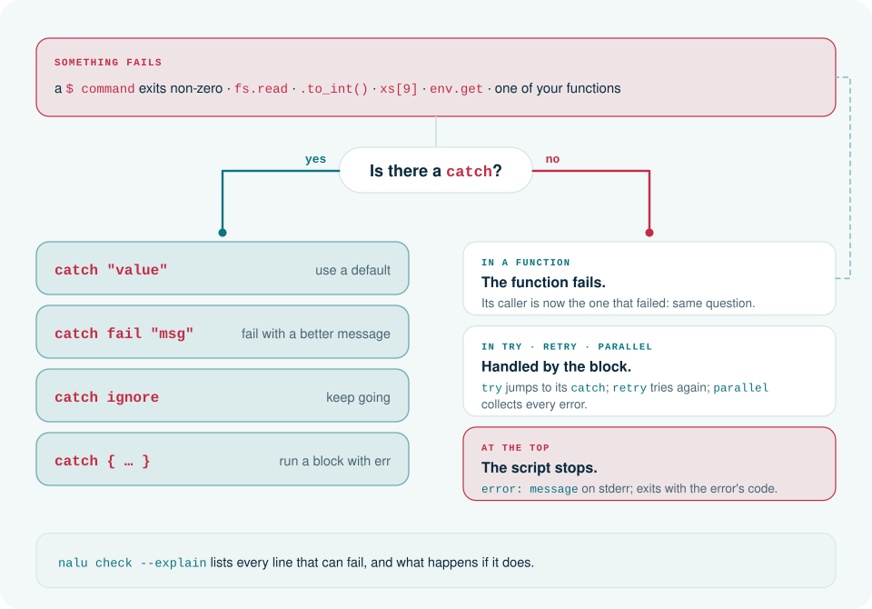
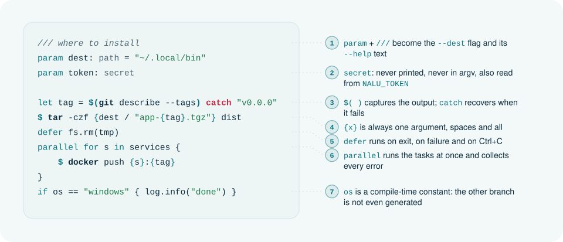
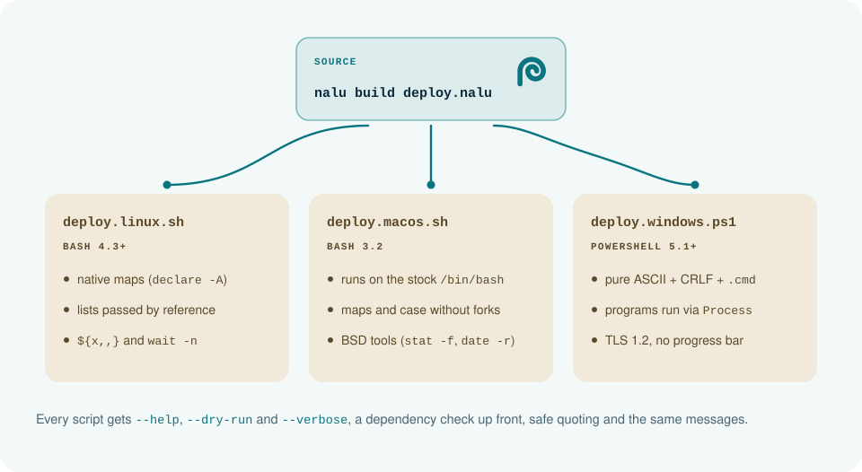
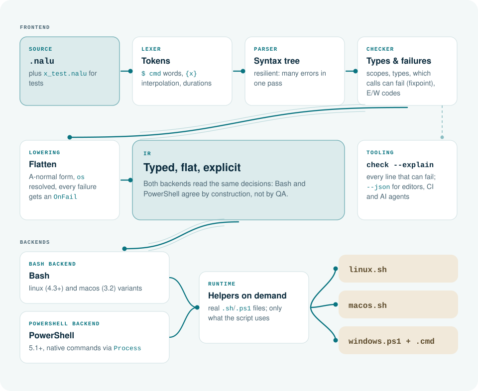

<p align="right"><b>English</b> · <a href="README.pt-BR.md">Português</a></p>

<picture>
  <source media="(prefers-color-scheme: dark)" srcset="docs/art/en/banner-dark.svg">
  
</picture>

<p align="center">
  
  
  
  
</p>

<p align="center">
  <a href="#install">Install</a> ·
  <a href="#quick-start">Quick start</a> ·
  <a href="docs/getting-started.md">Getting started</a> ·
  <a href="docs/recipes.md">Recipes</a> ·
  <a href="docs/language.md">Language reference</a> ·
  <a href="docs/stdlib.md">Standard library</a> ·
  <a href="llms.txt">llms.txt</a>
</p>

**Nalu** is a small, typed language for setup, build, deploy and install scripts. You write one `.nalu` file; the compiler checks it and writes **Bash** for Linux and macOS and **PowerShell** for Windows. The output is a plain, readable script, so there is nothing to install where it runs.

*Nalu* is Hawaiian for the wave that reaches the shore.

```rust
/// where to install
param dest: path = "~/.local/bin"
/// version to build; empty means the latest tag
param version: str = ""

let tag = if version != "" { version } else { $(git describe --tags) catch "v0.0.0" }
let tmp = fs.temp_dir()
defer fs.rm(tmp)

$ cargo build --release
fs.mkdir(dest)
fs.copy("target/release/app", dest / "app")
fs.chmod(dest / "app", "+x")
log.info("app {tag} installed in {dest}")
```

```console
$ nalu build install.nalu
$ ls dist
install.linux.sh   install.macos.sh   install.windows.ps1   install.windows.cmd

$ ./dist/install.macos.sh --dest ./out --dry-run
[dry-run] cargo build --release
[dry-run] fs.mkdir ./out
[dry-run] fs.copy target/release/app ./out/app
[dry-run] fs.chmod +x ./out/app
info: app v1.4.0 installed in ./out
```

Every generated script takes `--help` (written from the `///` comments), `--dry-run` and `--verbose`, checks that `git` and `cargo` exist before it starts, and quotes every argument.

## Why Nalu

<picture>
  <source media="(prefers-color-scheme: dark)" srcset="docs/art/en/why-dark.svg">
  
</picture>

Python, Node or a Go binary solve the same problem by asking the target machine to install something. Nalu goes the other way: the script it writes is the only thing that has to exist.

## Fail loud, recover with `catch`

<picture>
  <source media="(prefers-color-scheme: dark)" srcset="docs/art/en/errors-dark.svg">
  
</picture>

There is no `try` on every line and no `throws` in signatures: the compiler knows what can fail and propagates it. The trade-off is that a single line doesn't show whether it can fail, so the compiler tells you:

```console
$ nalu check --explain examples/deploy.nalu
examples/deploy.nalu:44:5: `$ docker` can fail → `publish` fails
examples/deploy.nalu:70:1: `$ docker` can fail → the script stops
examples/deploy.nalu:86:5: `wait_healthy` can fail → the script stops
8 places can fail without `catch`
```

The [VS Code extension](editors/vscode/README.md) shows the same marks in the editor.

## A script, annotated

<picture>
  <source media="(prefers-color-scheme: dark)" srcset="docs/art/en/anatomy-dark.svg">
  
</picture>

## One source, every target

<picture>
  <source media="(prefers-color-scheme: dark)" srcset="docs/art/en/targets-dark.svg">
  
</picture>

Linux and macOS get different Bash on purpose: Linux has Bash 4.3 or newer everywhere, so it gets native maps and lists passed by reference; macOS keeps the Bash 3.2 that ships with it. When something can't behave the same on every target, it is a compile error, never a script that fails quietly.

## Inside the compiler

<picture>
  <source media="(prefers-color-scheme: dark)" srcset="docs/art/en/pipeline-dark.svg">
  
</picture>

- **One tree of decisions.** Lowering produces a flat, typed IR in which every operation that can fail carries its own `OnFail`. Both backends only translate syntax, so Bash and PowerShell agree by construction.
- **Runtime helpers are real files** ([`runtime/bash`](runtime/bash), [`runtime/ps`](runtime/ps)) with their own unit tests in each shell; a script includes only the helpers it uses.
- **Tested in three shells.** `cargo test` runs every case on Bash 3.2, on Bash 5 (the Linux target) and on PowerShell 7, and compares the output.
- **Zero dependencies.** Rust standard library only; compiling a script takes milliseconds.

## Install

Download the binary for your system from the [latest release](https://github.com/JonathanSantos/nalu/releases/latest). It is a single file with nothing else to install.

| System | Architecture | Download |
|---|---|---|
| macOS | Apple Silicon | [`nalu-macos-arm64.tar.gz`](https://github.com/JonathanSantos/nalu/releases/latest/download/nalu-macos-arm64.tar.gz) |
| macOS | Intel | [`nalu-macos-x64.tar.gz`](https://github.com/JonathanSantos/nalu/releases/latest/download/nalu-macos-x64.tar.gz) |
| Linux | x86_64 (static) | [`nalu-linux-x64.tar.gz`](https://github.com/JonathanSantos/nalu/releases/latest/download/nalu-linux-x64.tar.gz) |
| Linux | ARM64 (static) | [`nalu-linux-arm64.tar.gz`](https://github.com/JonathanSantos/nalu/releases/latest/download/nalu-linux-arm64.tar.gz) |
| Windows | x86_64 | [`nalu-windows-x64.zip`](https://github.com/JonathanSantos/nalu/releases/latest/download/nalu-windows-x64.zip) |

Each release also has a [`checksums.txt`](https://github.com/JonathanSantos/nalu/releases/latest/download/checksums.txt) with the SHA-256 of every file. [All releases](https://github.com/JonathanSantos/nalu/releases).

```bash
# macOS and Linux: pick your file from the table, check it and put nalu on your PATH
curl -fsSLO https://github.com/JonathanSantos/nalu/releases/latest/download/nalu-macos-arm64.tar.gz
curl -fsSL https://github.com/JonathanSantos/nalu/releases/latest/download/checksums.txt | grep nalu-macos-arm64.tar.gz | shasum -a 256 -c -
mkdir -p ~/.local/bin && tar -xzf nalu-macos-arm64.tar.gz -C ~/.local/bin nalu
nalu --version
```

```powershell
# Windows
irm https://github.com/JonathanSantos/nalu/releases/latest/download/nalu-windows-x64.zip -OutFile nalu.zip
Expand-Archive nalu.zip -DestinationPath "$env:LOCALAPPDATA\nalu" -Force   # add this folder to your PATH
& "$env:LOCALAPPDATA\nalu\nalu.exe" --version
```

The binaries are not signed. On macOS, a file downloaded with the browser is quarantined: run `xattr -d com.apple.quarantine nalu` once (files fetched with `curl` are not affected).

To build from source instead, with a Rust toolchain: `cargo build --release` writes `target/release/nalu`.

## Quick start

```bash
nalu run script.nalu -- --name Ana         # compile for this system and run
nalu build script.nalu                     # dist/script.{linux,macos}.sh, .windows.ps1, .windows.cmd
nalu check script.nalu --explain           # errors, warnings and every line that can fail
nalu fmt .                                 # format every .nalu under this folder
nalu test tests/                           # run the `test` blocks
```

Start with the [getting started guide](docs/getting-started.md), then the [recipes](docs/recipes.md): an installer for `curl | bash` and `irm | iex` that verifies a SHA-256, an API call with a secret token, JSON config, backups with checksums, a CI step for three operating systems.

## Standard library

No imports: every module is always there, with the same behavior on the three targets.

| Module | What it covers |
|---|---|
| `fs` · `path` · `dirs` | files and folders, paths with the right separator, home and app folders |
| `env` · `sys` · `proc` | environment variables, architecture, admin and CI checks, `which` |
| `http` | `get`, `post`, `request` (PUT, PATCH, DELETE), `status` and `download`, with headers and a `bearer: secret` that never shows up in argv |
| `json` | `get`, `get_list`, `keys`, `has` and `quote`, parsed by the script itself (no `jq`) |
| `regex` · `encoding` | one regex syntax, checked by the compiler and identical on every target; Base64 |
| `hash` · `archive` | SHA-256 of text and files; `.tar.gz` and `.zip` |
| `pkg` · `semver` | install with the system's package manager (`apt-get`, `brew`, `winget`…); compare versions |
| `time` · `log` · `ui` | timestamps and durations, leveled logs, prompts that fall back without a terminal |

Full list: [docs/stdlib.md](docs/stdlib.md), generated from the compiler (`nalu doc --all`).

## Tooling

- **Diagnostics with codes.** Errors and warnings come with a stable code, the source line and a hint; `--json` for editors and agents.
- **Editor.** A dependency-free [VS Code extension](editors/vscode/README.md): highlighting, live checks, ⚡ on every line that can fail, types and docs on hover, completion by type, signature help, go to definition and format on save. The compiler answers every query (`nalu ide`), so the editor never guesses.
- **Formatter.** `nalu fmt` fixes indentation, spacing and blank lines and keeps your line breaks and comments; `nalu fmt --check` for CI.
- **For AI assistants.** The VS Code extension gives GitHub Copilot what the compiler knows: tools the agent calls to check its own code and look up the standard library (`#naluCheck`, `#naluDocs`), and instructions for chat. `nalu doc fs.copy` prints the docs for any name, and [llms.txt](llms.txt) is the whole language on one page, ready for a model's context.

## Status

Nalu 1.2. The compiler, both backends, the standard library above, the formatter and the editor tooling are done, and the test suite runs every case on Bash 3.2, Bash 5 and PowerShell 7. Compiler messages and everything the generated scripts print are in English and identical on the three targets. 1.1 added `regex` and `encoding`, `match` with guards and struct patterns, lists of lists, maps of lists, structs and lists of structs inside structs, scripts split across files with `use`, and `parallel` that really runs in parallel on Windows. 1.2 added `NAME=value` before a command, the `pkg` and `semver` modules, `http.request`, `archive.zip_create`, `list.concat` and `err` in the value after `catch`. Not there yet: floats and lists of maps; the [changelog](CHANGELOG.md) has the details.

## Learn more

| | |
|---|---|
| [Getting started](docs/getting-started.md) · [Recipes](docs/recipes.md) | first script, error handling, commands; ready-made tasks |
| [Language reference](docs/language.md) · [Standard library](docs/stdlib.md) | syntax, semantics, every function |
| [Vision](docs/vision.md) · [Architecture](docs/architecture.md) · [Decisions](docs/decisions.md) | why Nalu exists; the pipeline and the IR; why things are the way they are |
| [Brand](docs/brand/README.md) | the mark, color, type and tokens; README art in [`docs/art`](docs/art/build.py) |

## License

MIT
