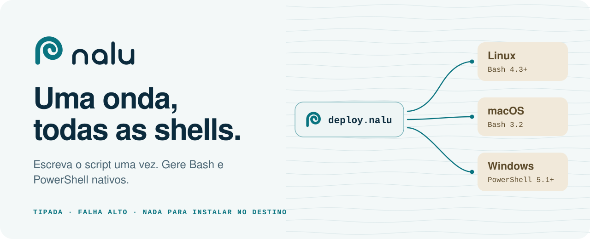
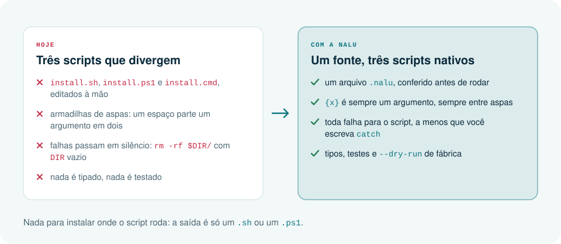
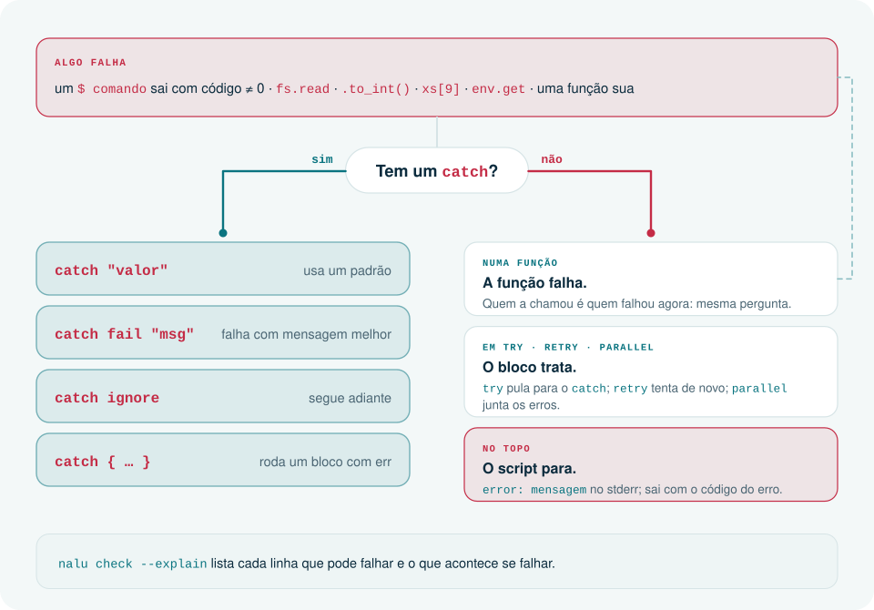
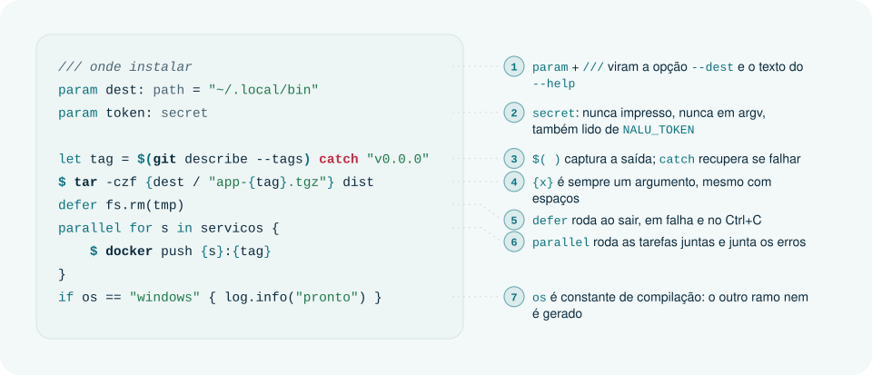
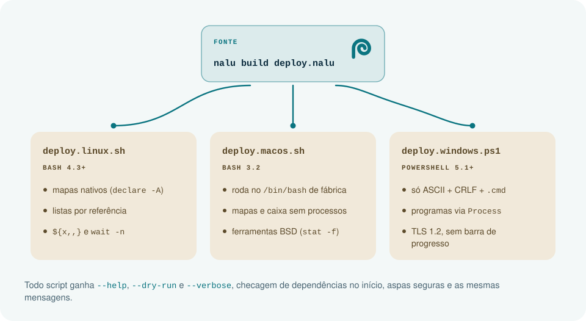
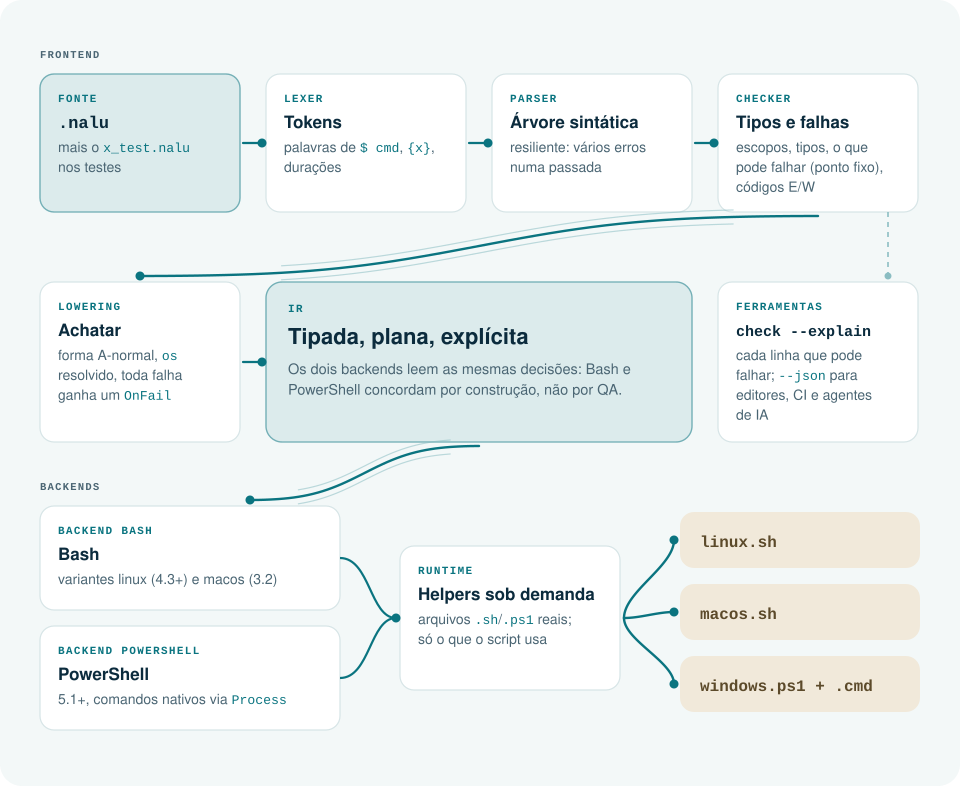

<p align="right"><a href="README.md">English</a> · <b>Português</b></p>

<picture>
  <source media="(prefers-color-scheme: dark)" srcset="docs/art/pt/banner-dark.svg">
  
</picture>

<p align="center">
  
  
  
  
</p>

<p align="center">
  <a href="#instalação">Instalação</a> ·
  <a href="#começo-rápido">Começo rápido</a> ·
  <a href="docs/getting-started.md">Primeiros passos</a> ·
  <a href="docs/recipes.md">Receitas</a> ·
  <a href="docs/language.md">Referência</a> ·
  <a href="docs/stdlib.md">Biblioteca padrão</a> ·
  <a href="llms.txt">llms.txt</a>
</p>

**Nalu** é uma linguagem pequena e tipada para scripts de setup, build, deploy e instalação. Você escreve um arquivo `.nalu`; o compilador confere e gera **Bash** para Linux e macOS e **PowerShell** para Windows. A saída é um script comum e legível, então não há nada para instalar onde ele roda.

*Nalu*, em havaiano, é a onda que chega à praia.

```rust
/// onde instalar
param destino: path = "~/.local/bin"
/// versão a compilar; vazio usa a última tag
param versao: str = ""

let tag = if versao != "" { versao } else { $(git describe --tags) catch "v0.0.0" }
let tmp = fs.temp_dir()
defer fs.rm(tmp)

$ cargo build --release
fs.mkdir(destino)
fs.copy("target/release/app", destino / "app")
fs.chmod(destino / "app", "+x")
log.info("app {tag} instalado em {destino}")
```

```console
$ nalu build instalar.nalu
$ ls dist
instalar.linux.sh   instalar.macos.sh   instalar.windows.ps1   instalar.windows.cmd

$ ./dist/instalar.macos.sh --destino ./saida --dry-run
[dry-run] cargo build --release
[dry-run] fs.mkdir ./saida
[dry-run] fs.copy target/release/app ./saida/app
[dry-run] fs.chmod +x ./saida/app
info: app v1.4.0 instalado em ./saida
```

Todo script gerado aceita `--help` (escrito a partir dos comentários `///`), `--dry-run` e `--verbose`, confere se `git` e `cargo` existem antes de começar e põe cada argumento entre aspas.

## Por que a Nalu

<picture>
  <source media="(prefers-color-scheme: dark)" srcset="docs/art/pt/why-dark.svg">
  
</picture>

Python, Node ou um binário Go resolvem o mesmo problema pedindo que a máquina de destino instale alguma coisa. A Nalu vai pelo outro lado: o script que ela escreve é a única coisa que precisa existir.

## Falha alto, recupera com `catch`

<picture>
  <source media="(prefers-color-scheme: dark)" srcset="docs/art/pt/errors-dark.svg">
  
</picture>

Não há `try` em cada linha nem `throws` nas assinaturas: o compilador sabe o que pode falhar e cuida da propagação. O preço é que uma linha sozinha não mostra se pode falhar; por isso o compilador conta:

```console
$ nalu check --explain examples/deploy.nalu
examples/deploy.nalu:44:5: `$ docker` can fail → `publish` fails
examples/deploy.nalu:70:1: `$ docker` can fail → the script stops
examples/deploy.nalu:86:5: `wait_healthy` can fail → the script stops
8 places can fail without `catch`
```

A [extensão do VS Code](editors/vscode/README.md) mostra as mesmas marcas no editor.

## Um script, anotado

<picture>
  <source media="(prefers-color-scheme: dark)" srcset="docs/art/pt/anatomy-dark.svg">
  
</picture>

## Um fonte, todos os alvos

<picture>
  <source media="(prefers-color-scheme: dark)" srcset="docs/art/pt/targets-dark.svg">
  
</picture>

Linux e macOS ganham Bash diferente de propósito: todo Linux tem Bash 4.3 ou mais novo, então ele ganha mapas nativos e listas passadas por referência; o macOS fica com o Bash 3.2 que vem nele. Quando algo não consegue se comportar igual em todos os alvos, é erro de compilação, nunca um script que falha em silêncio.

## Por dentro do compilador

<picture>
  <source media="(prefers-color-scheme: dark)" srcset="docs/art/pt/pipeline-dark.svg">
  
</picture>

- **Uma árvore de decisões.** O lowering produz uma IR plana e tipada em que toda operação que pode falhar traz o seu próprio `OnFail`. Os dois backends só traduzem sintaxe, então Bash e PowerShell concordam por construção.
- **Os helpers de runtime são arquivos de verdade** ([`runtime/bash`](runtime/bash), [`runtime/ps`](runtime/ps)), com testes de unidade em cada shell; um script inclui só os helpers que usa.
- **Testada em três shells.** O `cargo test` roda cada caso no Bash 3.2, no Bash 5 (o alvo Linux) e no PowerShell 7, e compara a saída.
- **Zero dependências.** Só a biblioteca padrão do Rust; compilar um script leva milissegundos.

## Instalação

Baixe o binário do seu sistema no [release mais recente](https://github.com/JonathanSantos/nalu/releases/latest). É um arquivo só, sem mais nada para instalar.

| Sistema | Arquitetura | Download |
|---|---|---|
| macOS | Apple Silicon | [`nalu-macos-arm64.tar.gz`](https://github.com/JonathanSantos/nalu/releases/latest/download/nalu-macos-arm64.tar.gz) |
| macOS | Intel | [`nalu-macos-x64.tar.gz`](https://github.com/JonathanSantos/nalu/releases/latest/download/nalu-macos-x64.tar.gz) |
| Linux | x86_64 (estático) | [`nalu-linux-x64.tar.gz`](https://github.com/JonathanSantos/nalu/releases/latest/download/nalu-linux-x64.tar.gz) |
| Linux | ARM64 (estático) | [`nalu-linux-arm64.tar.gz`](https://github.com/JonathanSantos/nalu/releases/latest/download/nalu-linux-arm64.tar.gz) |
| Windows | x86_64 | [`nalu-windows-x64.zip`](https://github.com/JonathanSantos/nalu/releases/latest/download/nalu-windows-x64.zip) |

Cada release traz também um [`checksums.txt`](https://github.com/JonathanSantos/nalu/releases/latest/download/checksums.txt) com o SHA-256 de cada arquivo. [Todos os releases](https://github.com/JonathanSantos/nalu/releases).

```bash
# macOS e Linux: escolha o arquivo na tabela, confira e ponha o nalu no PATH
curl -fsSLO https://github.com/JonathanSantos/nalu/releases/latest/download/nalu-macos-arm64.tar.gz
curl -fsSL https://github.com/JonathanSantos/nalu/releases/latest/download/checksums.txt | grep nalu-macos-arm64.tar.gz | shasum -a 256 -c -
mkdir -p ~/.local/bin && tar -xzf nalu-macos-arm64.tar.gz -C ~/.local/bin nalu
nalu --version
```

```powershell
# Windows
irm https://github.com/JonathanSantos/nalu/releases/latest/download/nalu-windows-x64.zip -OutFile nalu.zip
Expand-Archive nalu.zip -DestinationPath "$env:LOCALAPPDATA\nalu" -Force   # ponha esta pasta no PATH
& "$env:LOCALAPPDATA\nalu\nalu.exe" --version
```

Os binários não são assinados. No macOS, um arquivo baixado pelo navegador fica em quarentena: rode `xattr -d com.apple.quarantine nalu` uma vez (arquivos baixados com `curl` não são afetados).

Para compilar do código-fonte, com o Rust instalado: `cargo build --release` gera `target/release/nalu`.

## Começo rápido

```bash
nalu run script.nalu -- --nome Ana         # compila para este sistema e executa
nalu build script.nalu                     # dist/script.{linux,macos}.sh, .windows.ps1, .windows.cmd
nalu check script.nalu --explain           # erros, avisos e cada linha que pode falhar
nalu fmt .                                 # formata todo .nalu desta pasta para baixo
nalu test testes/                          # roda os blocos `test`
```

Comece pelos [primeiros passos](docs/getting-started.md) e depois pelas [receitas](docs/recipes.md) (a documentação é em inglês): um instalador para `curl | bash` e `irm | iex` que confere o SHA-256, uma chamada de API com token secreto, configuração em JSON, backup com checksums, um passo de CI para três sistemas.

## Biblioteca padrão

Sem `import`: todo módulo está sempre disponível, com o mesmo comportamento nos três alvos.

| Módulo | O que cobre |
|---|---|
| `fs` · `path` · `dirs` | arquivos e pastas, caminhos com o separador certo, pasta do usuário e do app |
| `env` · `sys` · `proc` | variáveis de ambiente, arquitetura, administrador e CI, `which` |
| `http` | `get`, `post`, `status` e `download`, com cabeçalhos e um `bearer: secret` que nunca aparece em argv |
| `json` | `get`, `get_list`, `keys`, `has` e `quote`, interpretado pelo próprio script (sem `jq`) |
| `regex` · `encoding` | uma sintaxe de regex, conferida pelo compilador e igual em todos os alvos; Base64 |
| `hash` · `archive` | SHA-256 de texto e de arquivo; `.tar.gz` e `.zip` |
| `time` · `log` · `ui` | instantes e durações, logs por nível, perguntas que têm resposta padrão sem terminal |

Lista completa: [docs/stdlib.md](docs/stdlib.md), gerada pelo próprio compilador (`nalu doc --all`). Ainda planejado: `pkg`.

## Ferramentas

- **Diagnósticos com código.** Erros e avisos vêm com um código estável, a linha do fonte e uma dica; `--json` para editores e agentes.
- **Editor.** Uma [extensão do VS Code](editors/vscode/README.md) sem dependências: realce, checagem enquanto você digita, ⚡ em cada linha que pode falhar, tipos e documentação no hover, completar pelo tipo, ajuda de assinatura, ir para a definição e formatar ao salvar. Quem responde é o compilador (`nalu ide`), então o editor nunca chuta.
- **Formatador.** `nalu fmt` acerta indentação, espaços e linhas em branco e mantém suas quebras de linha e comentários; `nalu fmt --check` para o CI.
- **Para assistentes de IA.** A extensão do VS Code passa ao GitHub Copilot o que o compilador sabe: ferramentas que o agente chama para conferir o próprio código e consultar a stdlib (`#naluCheck`, `#naluDocs`) e instruções para o chat. `nalu doc fs.copy` mostra a documentação de qualquer nome, e o [llms.txt](llms.txt) é a linguagem inteira numa página, pronta para o contexto de um modelo.

## Estado

Nalu 1.1. O compilador, os dois backends, a biblioteca acima, o formatador e as ferramentas de editor estão prontos, e a suíte de testes roda cada caso no Bash 3.2, no Bash 5 e no PowerShell 7. As mensagens do compilador e tudo o que os scripts gerados imprimem são em inglês e iguais nos três alvos, e a documentação em [`docs/`](docs/README.md) é em inglês. A 1.1 trouxe `regex` e `encoding`, `match` com guardas e padrões de struct, listas de listas, mapas de listas, structs e listas de structs dentro de struct, scripts divididos em vários arquivos com `use` e `parallel` de verdade no Windows. Ainda não tem: números com vírgula, listas de mapas e o módulo `pkg`; o [changelog](CHANGELOG.md) tem os detalhes.

## Saiba mais

Toda a documentação é em inglês.

| | |
|---|---|
| [Primeiros passos](docs/getting-started.md) · [Receitas](docs/recipes.md) | o primeiro script, tratamento de erros, comandos; tarefas prontas |
| [Referência da linguagem](docs/language.md) · [Biblioteca padrão](docs/stdlib.md) | sintaxe, semântica, cada função |
| [Visão](docs/vision.md) · [Arquitetura](docs/architecture.md) · [Decisões](docs/decisions.md) | por que a Nalu existe; o pipeline e a IR; por que as coisas são como são |
| [Marca](docs/brand/README.md) | o símbolo, as cores, a tipografia e os tokens; a arte do README em [`docs/art`](docs/art/build.py) |

## Licença

MIT
